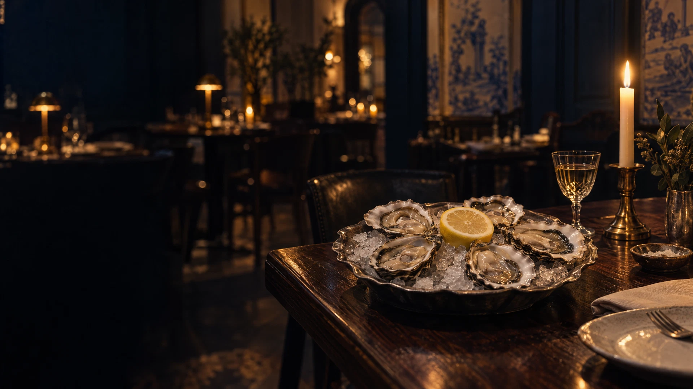

# Ondine — Seafood Bistro

A faithful rebuild of the **Ondine** seafood bistro website — an Atlantic-led restaurant in Lisbon's Chiado — using **React and TypeScript**. The layout, copy, seasonal menu, photography and visual design are preserved from the original static site.

> Original design and content: [ondine-bistr-qi9tep8y.manus.space](https://ondine-bistr-qi9tep8y.manus.space/). This repository is a reproduction for learning and portfolio purposes.

## Preview



## What's included

- **One-page restaurant site** — hero, introduction, seasonal menu, full-bleed interlude, chef's story, visit details, reservations and a large footer.
- **Responsive, mobile-first layout** — down to 320 px, with an animated mobile navigation menu.
- **Motion** — scroll-triggered reveals, subtle hero parallax and hover transitions. All motion respects `prefers-reduced-motion`.
- **Working reservation form** — validates dates (Tuesday–Sunday, up to 90 days ahead), generates available seating times for the selected day, validates party size, name and email, and stores the request in `localStorage`. Saved requests are restored on the next visit and can be edited.
- **Typed content** — all menu and page copy lives in `src/data` behind shared interfaces in `src/types`; components render data and contain no hardcoded menu content.
- **Accessibility** — skip link, landmarks, labelled form controls, visible focus states and ARIA state on the mobile menu toggle.
- **Self-contained assets** — photography and the favicon are stored locally; only Google Fonts is loaded from a CDN.

## Tech stack

- **React 19** with **TypeScript** in strict mode
- **Vite 8** for development and production builds
- **React hooks** for navigation state, form state, scroll reveals and hero parallax
- **Plain CSS** — Grid, Flexbox, `clamp()` and custom properties, split by section
- **Google Fonts** — Cormorant Garamond and DM Sans
- **localStorage** for the demo reservation flow (no backend)

The site is a single page with anchor navigation, so React Router is intentionally not used.

## Project structure

```text
.
├── index.html                 # Vite HTML entry and document metadata
├── vite.config.ts             # Vite + React configuration
├── tsconfig*.json             # Strict TypeScript project configs
├── public
│   └── favicon.svg
├── src
│   ├── components             # Navbar, Hero, MenuSection, Reservations, Footer, etc.
│   ├── pages
│   │   └── HomePage.tsx       # Composes the one-page site
│   ├── data
│   │   ├── menu.ts            # Typed seasonal menu
│   │   └── site.ts            # Typed page copy, navigation and form content
│   ├── types
│   │   └── index.ts           # Shared interfaces
│   ├── hooks                  # Reveal, parallax and reservation controllers
│   ├── utils
│   │   └── reservation.ts     # Date, seating and storage helpers
│   ├── assets
│   │   └── images             # Five WebP photographs
│   ├── styles                 # Section CSS plus responsive rules
│   ├── App.tsx
│   ├── main.tsx
│   └── vite-env.d.ts
├── old                        # Archived original HTML, CSS and JavaScript
├── LICENSE
└── README.md
```

## Install and run

Requires Node.js 20.19+ or 22.12+.

```bash
npm install
npm run dev
```

Open the URL printed by Vite (usually `http://localhost:5173`).

### Production build

```bash
npm run build
npm run preview
```

The production output is written to `dist/`.

## Reservation form

The form is a front-end demo. Submitting it stores a request under the `ondine.table-request.v1` key in the browser's `localStorage`; nothing is sent to a server and no table is actually booked. Requests can be edited from the confirmation panel, and the saved request is restored on the next visit.

## Archived original

The original non-React implementation is preserved in [`old/index.html`](old/index.html), [`old/style.css`](old/style.css) and [`old/main.js`](old/main.js) for reference. The original images now live in `src/assets/images`.

## License

The repository is licensed under the [Apache License 2.0](LICENSE). The original Ondine design, copy and photography remain the property of their respective creators.
