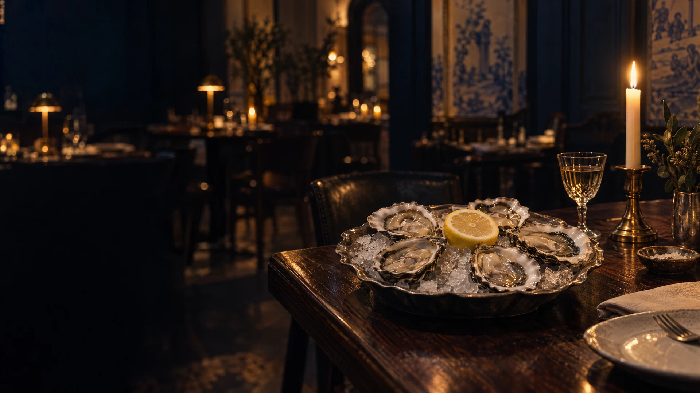

# Ondine — Seafood Bistro

A fully static reproduction of the **Ondine** seafood bistro website — an Atlantic-led restaurant in Lisbon's Chiado. Built with plain HTML, CSS and vanilla JavaScript, with no frameworks and no build step.

> Original design and content: [ondine-bistr-qi9tep8y.manus.space](https://ondine-bistr-qi9tep8y.manus.space/). This repository is a static reproduction for learning and portfolio purposes.

## Preview



## What's included

- **Complete one-page site** — hero, seasonal menu, interlude, chef's story, visit details, reservations and footer.
- **Responsive layout** — designed for desktop, tablet and mobile (down to 320 px), including an animated mobile navigation menu.
- **Motion** — scroll-triggered reveals, subtle hero parallax, and hover transitions. Respects `prefers-reduced-motion`.
- **Working reservation form** — validates the date (Tuesday–Sunday, up to 90 days ahead), generates available seating times, checks party size and email, and saves the request in `localStorage`.
- **Self-contained assets** — all photography and the favicon are stored locally; only the Google Fonts stylesheet is loaded from a CDN.
- **Accessibility touches** — skip link, landmarks, labelled form controls, visible focus states and ARIA state on the menu toggle.

## Project structure

```text
.
├── index.html          # Markup for the whole site
├── assets
│   ├── style.css       # Layout, typography and responsive rules
│   └── main.js         # Navigation, reveals, parallax and reservation logic
├── images              # Five WebP photographs
├── favicon.svg
├── LICENSE
└── README.md
```

## Run locally

The page uses an ES module, so serve it over HTTP rather than opening `index.html` directly.

```bash
npx --yes serve .
```

Then open the URL printed in the terminal (usually `http://localhost:3000`).

Any static server works, for example:

```bash
npx --yes http-server -p 4173
```

## Reservation form

The form is a front-end demo. Submitting it stores a request under the `ondine.table-request.v1` key in the browser's `localStorage`; nothing is sent to a server and no table is actually booked. Requests can be edited from the confirmation panel, and the saved request is restored on the next visit.

## Tech

- Semantic HTML5
- Modern CSS (Grid, Flexbox, `clamp()`, custom properties)
- Vanilla JavaScript (IntersectionObserver, localStorage, native form validation)
- Google Fonts: Cormorant Garamond + DM Sans

## License

The repository is licensed under the [Apache License 2.0](LICENSE). The original Ondine design, copy and photography remain the property of their respective creators.
