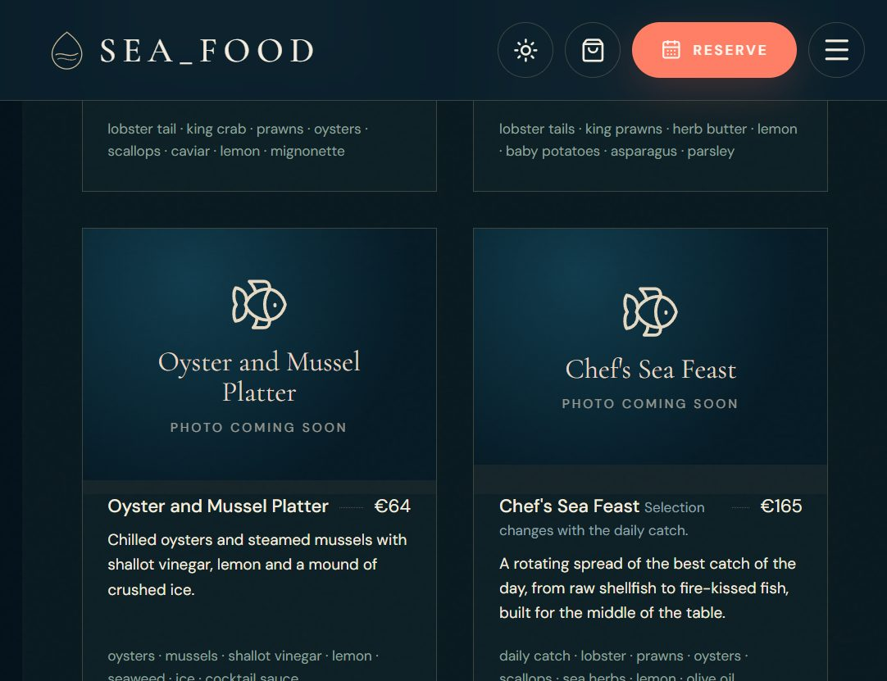
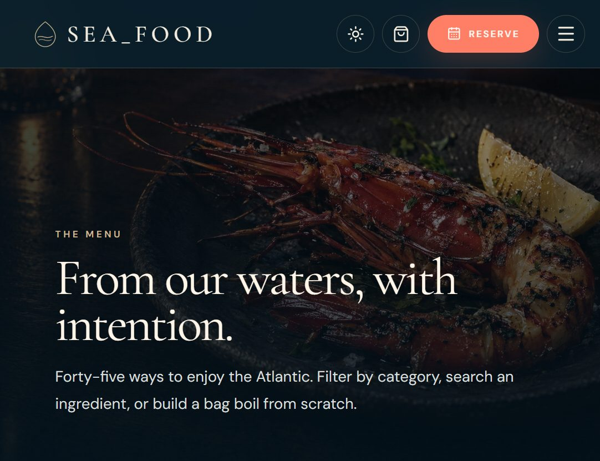
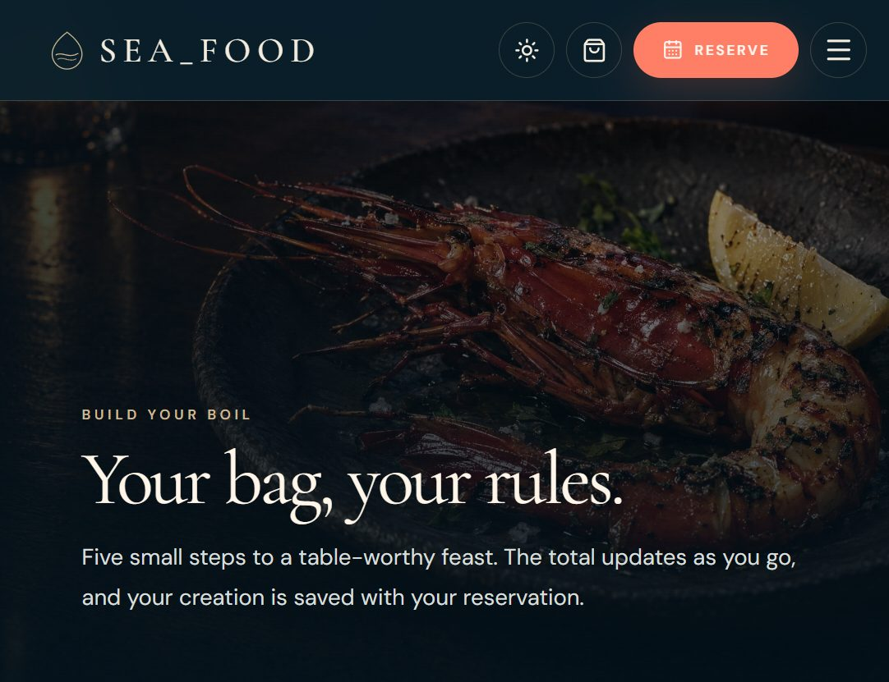
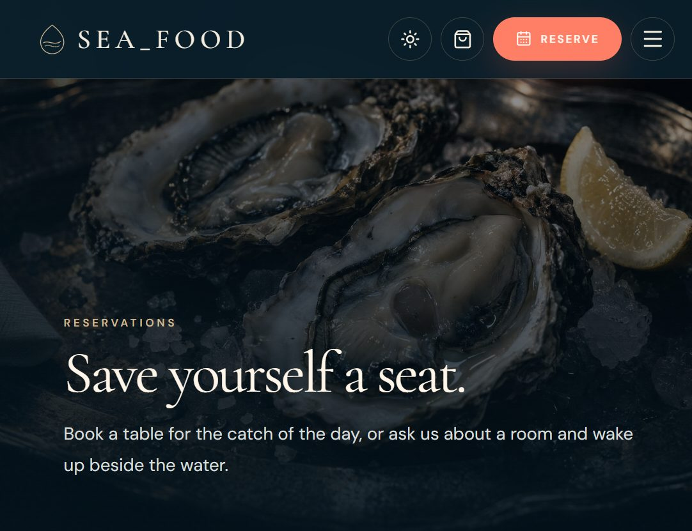

# Sea_Food Hotel & Resort

A multi-page seaside hotel and booking platform built with **React + TypeScript + Vite**. It brings together Atlantic seafood, a build-your-own bag boil wizard, rooms and suites, experiences, a gallery with lightbox, and a local reservation flow — all in one ocean-blue, sand and coral design system.

> **Demo launch:** the hotel name, tagline, contact details, prices and map coordinates are realistic demo values for the competition entry, marked with `// DEMO` comments. Many photographs still use gradient fallbacks until real photos are added.

## Screenshots

Captured from the production preview build:

| Home | Menu |
| --- | --- |
|  |  |

| Bag Boil Builder | Reservations |
| --- | --- |
|  |  |

## What's included

- **12 lazy-loaded routes** with animated transitions, scroll-to-top and per-page SEO metadata.
- **Shared layout** — sticky navbar that starts transparent over the hero and turns solid on scroll, mobile hamburger menu, newsletter/social footer, light/dark theme toggle persisted to `localStorage`.
- **Menu** — 45 typed dishes from the single `src/data/dishes.ts` catalogue, now covering Crab Boil, Bag Boil, Platters, Grilled, Starters, Raw Bar, Small Plates, Mains and Desserts, with category filters, search, sorting, badges, spice meters and demo pricing.
- **Dish detail pages** — ingredients, serving size, heat level, tags, and “Add to reservation”.
- **Bag Boil Builder** — five-step wizard (size → seafood → extras → sauce & heat → review) with an animated bag illustration and a live indicative total.
- **Bookings** — react-hook-form + zod validated table reservations, room enquiries and contact messages, emailed through Formspree when configured and saved in `localStorage`, with a confirmation page and a “My Reservation” drawer.
- **Legal pages** — simple Privacy and Terms pages linked in the footer.
- **Rooms & Suites** — four seaside rooms with amenity lists and enquiry links that pre-fill the room form.
- **Gallery** — 16-item masonry gallery with category filters, keyboard/swipe lightbox and graceful image fallbacks.
- **Experiences & Events**, **About**, **Contact & Location** with an embedded map, plus a friendly **404**.
- **Home page** — hero with parallax, original bistro sections, featured dishes, chef's pick carousel, testimonials, counters and calls to action.
- **Accessibility and polish** — semantic landmarks, skip link, labelled controls, visible focus states, `aria-*` state, reduced-motion support, responsive layouts at 375 px / 768 px / 1280 px, lazy images with explicit dimensions, and reusable fallbacks for missing photos.

## Stack

| Concern | Choice |
| --- | --- |
| UI | React 19 + TypeScript (strict) |
| Build | Vite 8 |
| Routing | react-router-dom 7 |
| Motion | framer-motion |
| Forms | react-hook-form + zod + @hookform/resolvers |
| Icons | lucide-react |
| SEO | react-helmet-async |
| Styling | Plain CSS design system with CSS variables (two fonts: Cormorant Garamond + DM Sans) |
| Linting | ESLint 10 flat config with typescript-eslint |

## Run locally

```bash
npm install
npm run dev
```

Open the URL printed by Vite (usually `http://localhost:5173`).

```bash
npm run build   # type-check + production build
npm run lint    # ESLint
npm run preview # preview the production build
```

### Email forms

The reservation, room enquiry and contact forms use free [Formspree](https://formspree.io) endpoints — no backend required. Copy `.env.example` to `.env` and add a form URL for each form:

```dotenv
VITE_FORMSPREE_RESERVATION_ENDPOINT=https://formspree.io/f/your-form-id
VITE_FORMSPREE_ROOM_ENQUIRY_ENDPOINT=https://formspree.io/f/your-form-id
VITE_FORMSPREE_CONTACT_ENDPOINT=https://formspree.io/f/your-form-id
```

`.env` is gitignored. With no endpoints configured, submissions are still saved locally so the demo flow keeps working; no email is sent. Restart the dev server after changing `.env`.

## Pages

| Route | Page |
| --- | --- |
| `/` | Home — hero, dining story, featured dishes, teasers, testimonials |
| `/menu` | Full menu with filters, search and sort |
| `/menu/:slug` | Dish detail and add-to-reservation |
| `/build-your-boil` | Bag Boil Builder wizard |
| `/rooms` | Rooms & Suites |
| `/reservations` | Table reservation + room enquiry forms |
| `/reservations/confirmation` | Saved booking confirmation |
| `/gallery` | Photo gallery with lightbox |
| `/experiences` | Experiences & Events |
| `/about` | Our story and values |
| `/contact` | Contact details, map and message form |
| `/privacy` | Privacy policy |
| `/terms` | Terms of use |
| `*` | 404 |

## Folder structure

```text
src/
├── assets/images/          Original WebP photography
├── config/site.ts          Hotel name, contact details, coordinates, currency, social links (DEMO)
├── context/                Cart and UI drawer providers
├── data/                   dishes (single dish source of truth), rooms, events, testimonials, gallery, site copy
├── hooks/                  Theme, scroll reveal, hero parallax, legacy reservation hook
├── types/                  Strict shared domain types
├── utils/                  Storage, booking persistence, boil pricing, date helpers, sendEmail
├── components/
│   ├── layout/             Navbar, Footer, RootLayout, PageTransition, ScrollToTop, ReservationDrawer
│   ├── common/             Seo, PageHero, SectionHeading, ImageWithFallback, LegalPage, Badge, Price, SpiceMeter, Counter
│   ├── cards/              DishCard, RoomCard, EventCard, TestimonialCard
│   ├── home/               HomeHero, FeaturedDishes, BuildTeaser, RoomsPreview, ChefPick, TestimonialsCarousel, GalleryStrip, HomeCta
│   ├── menu/               MenuFilters, DishGrid
│   ├── builder/            BoilBuilder, BagIllustration
│   ├── gallery/            GalleryGrid, Lightbox
│   └── forms/              ReservationForm, RoomEnquiryForm, ContactForm
├── pages/                  Lazy-loaded route components (including Privacy and Terms)
├── styles/                 Design system, component styles, page styles, theme, responsive
├── vite-env.d.ts           Typed VITE_FORMSPREE_* environment variables
├── App.tsx                 Router
└── main.tsx                Providers and entry point
```

## Images and placeholders

- Existing dish photos live in `public/images/seafood/*.png`.
- New dish, room, event and gallery photos follow `/images/<group>/<slug>.jpg` paths. Missing files render a reusable gradient + fish icon fallback with the item name, so the site never shows broken images.
- **All prices are demo values** marked with `// DEMO`. Dish, room, event and builder prices are aligned: the default Couples boil (€52 base + crab €18 + shrimp €9 + corn €3 + potatoes €4) matches the €86 Couples Bag Boil dish.
- Contact details, address, social URLs and map coordinates are demo values in `src/config/site.ts`; the contact map centres on the configured coordinates.

## Notes

The original one-page Ondine site and its working reservation form are preserved inside the Home route; the new reservation flow adds the react-hook-form/zod version without removing the earlier functionality. The archived static site remains under `old/`.
